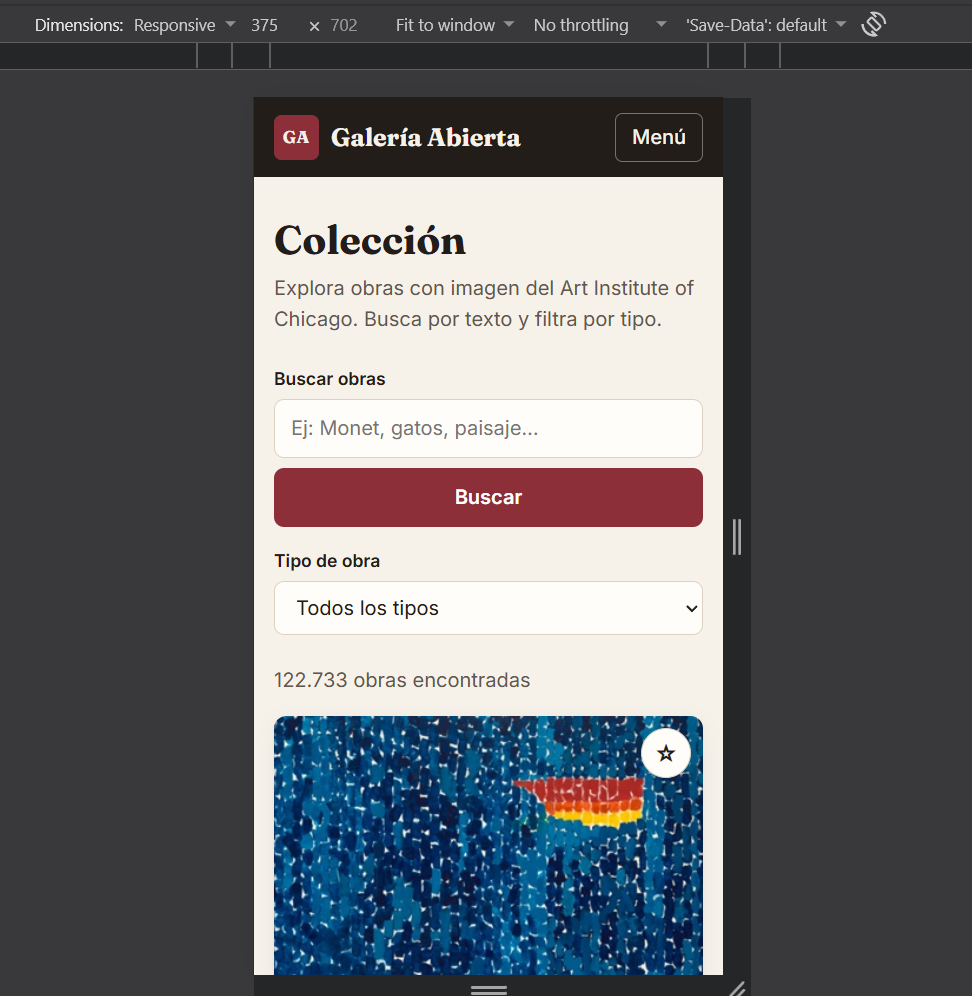
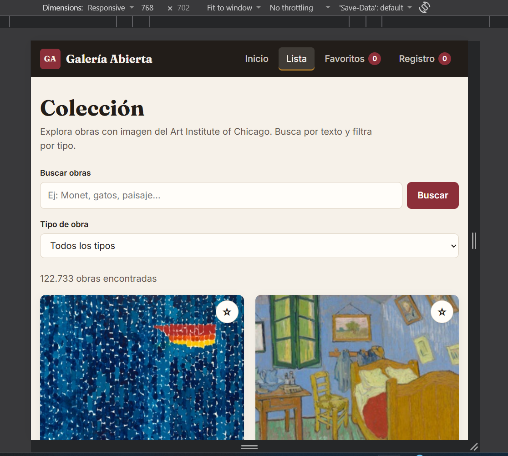
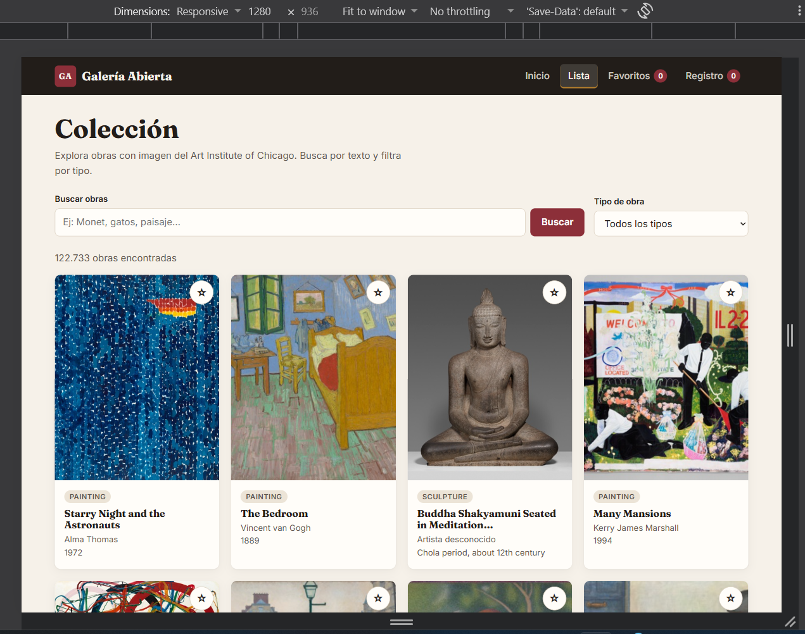
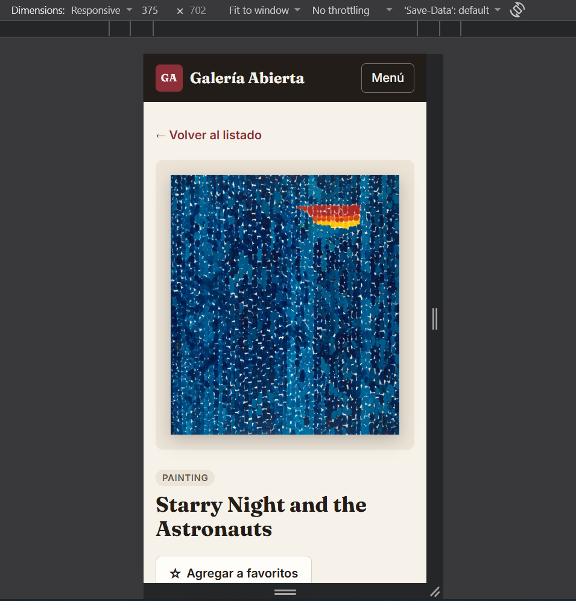
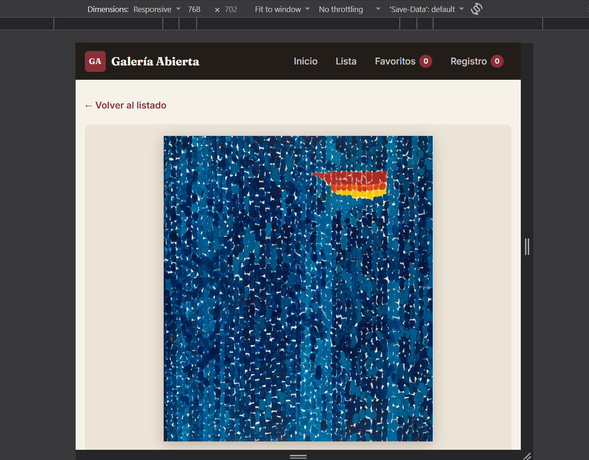
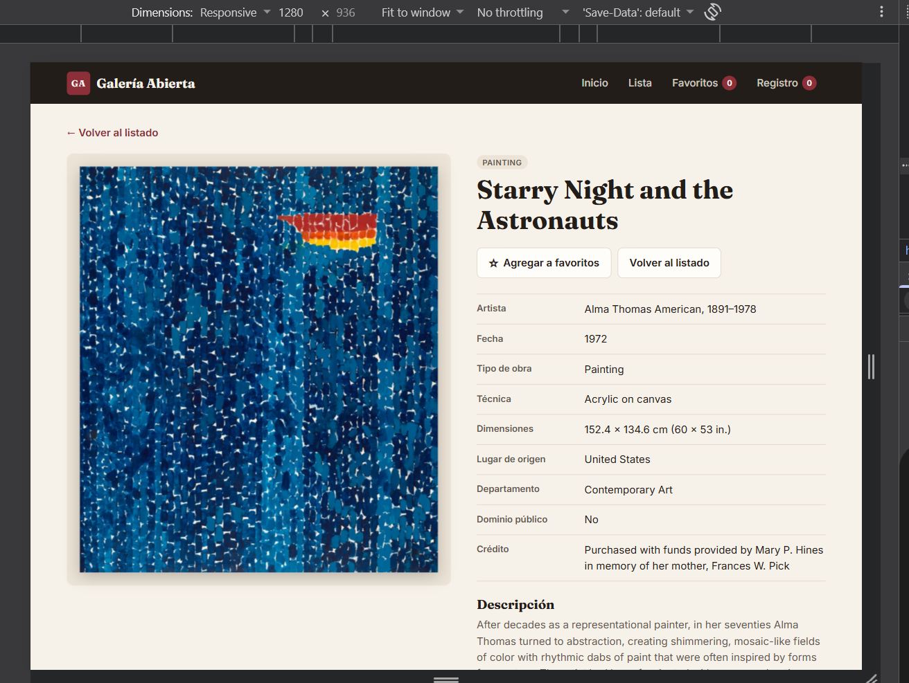
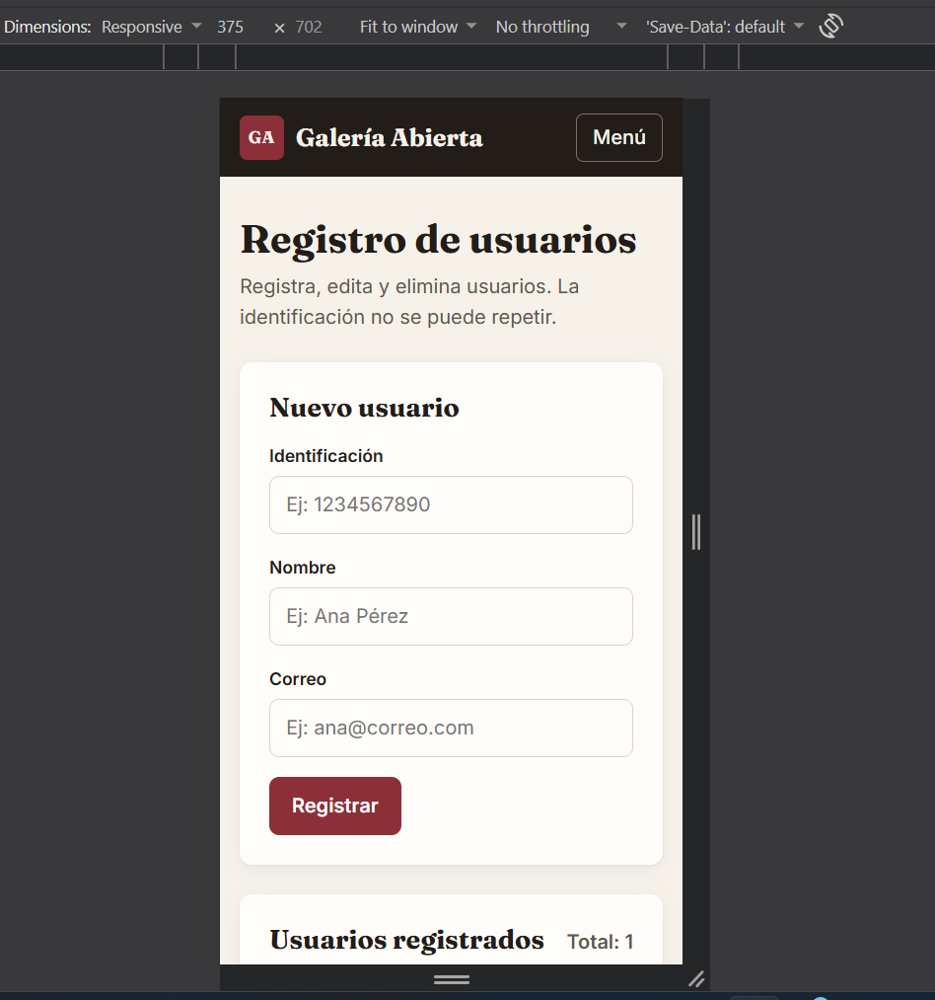
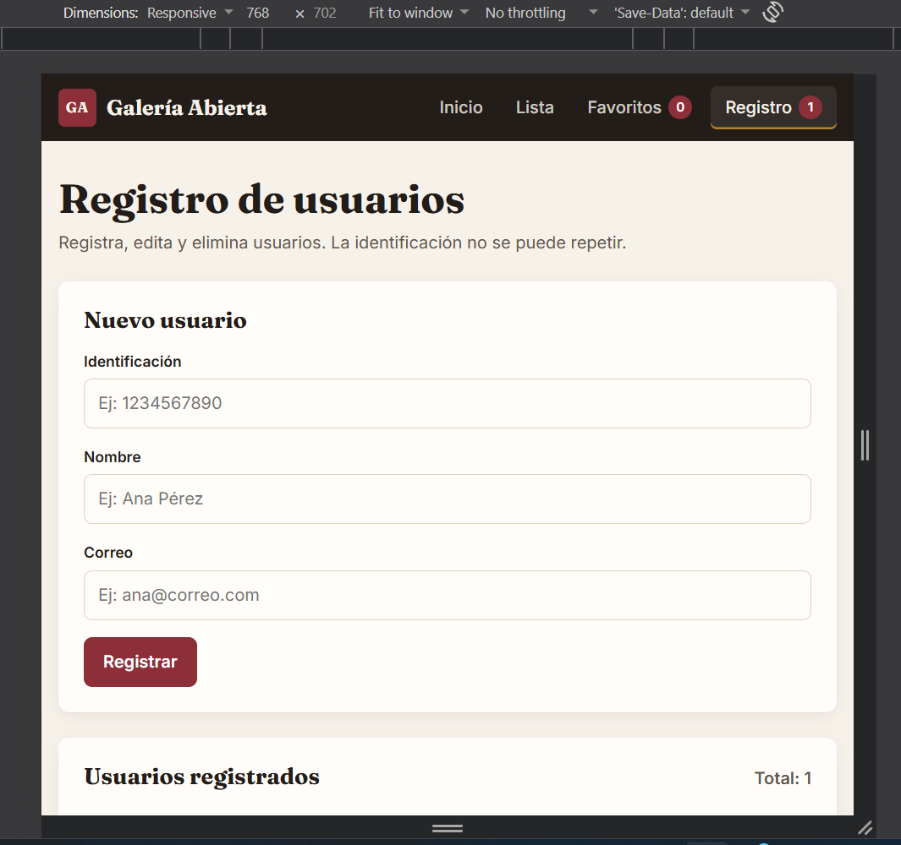
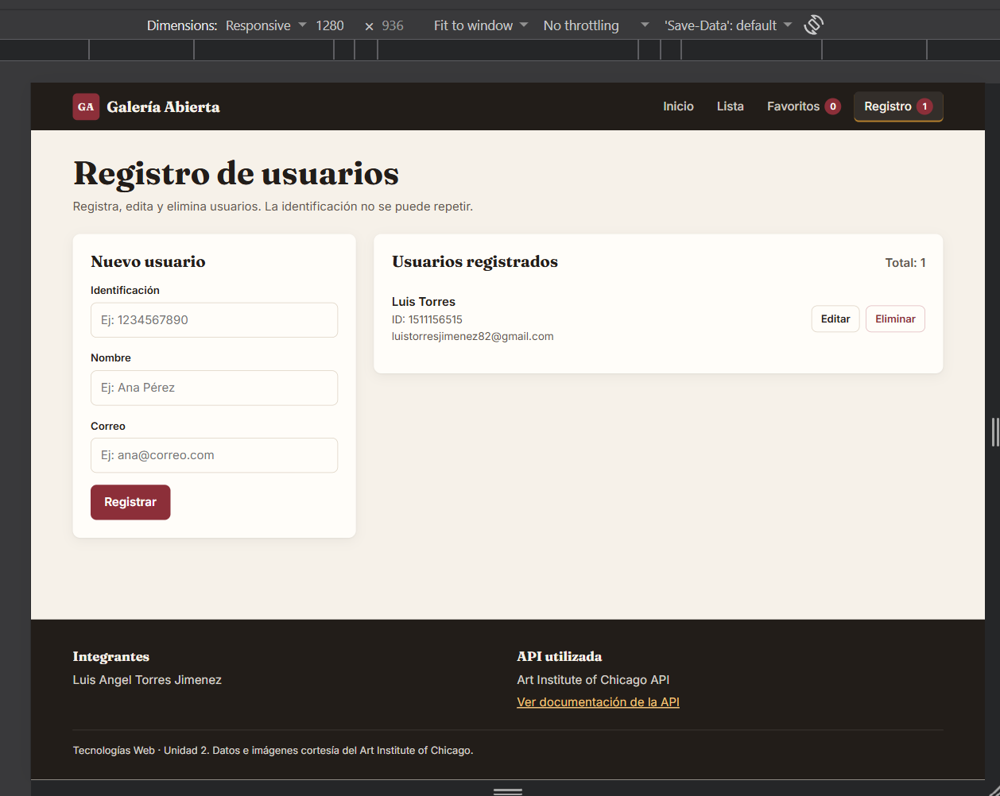

# Galería Abierta — Explorador del Art Institute of Chicago

Aplicación web hecha con **React + Vite** para explorar la colección del Art Institute of Chicago:
listado de obras con buscador, filtro por tipo y paginación, detalle de cada obra, favoritos
guardados en `localStorage` y un registro de usuarios con CRUD completo y validaciones.

Proyecto de Tecnologías Web · Unidad 2.

## Integrantes

- Luis Angel Torres Jimenez

## API utilizada

- **Nombre:** Art Institute of Chicago API (gratuita, sin clave)
- **URL base:** `https://api.artic.edu/api/v1`
- **Documentación:** https://api.artic.edu/docs/

| Uso en la app | Endpoint |
| --- | --- |
| Listado, búsqueda, filtro y paginación | `GET /artworks/search?q={texto}&page={n}&limit=12&fields=...` con filtros `query[bool][filter]` (obras con imagen y `artwork_type_id`) |
| Opciones del filtro "Tipo de obra" | `GET /artwork-types?limit=100` (con `fields` la API responde 500) |
| Detalle de una obra | `GET /artworks/{id}` |
| Imágenes (servicio IIIF) | `https://www.artic.edu/iiif/2/{image_id}/full/843,/0/default.jpg`, pedidas a través del proxy `/iiif` (ver abajo) |

Cloudflare, delante de los servidores del museo, responde a las imágenes IIIF con un desafío
anti-bots (403) salvo que el `Referer` sea de `artic.edu`, y el navegador no deja fijar ese
`Referer` desde la app. Por eso la app pide las imágenes a `/iiif/...` en su propio dominio:
en desarrollo y en `npm run preview` las reenvía el proxy de `vite.config.js`, y en Vercel la
función `api/iiif.js`. A la API (`api.artic.edu`) se le pide sin `Referer`, porque con
`Referer: http://localhost:5173/` también responde 403.

La API limita a 60 peticiones por minuto, por eso el buscador consulta al enviar el formulario
(botón **Buscar**) y no con cada tecla. Además, la API no permite pasar de 10.000 resultados por
búsqueda, así que la paginación se limita a ese máximo.

## Pantallas y rutas

| Ruta | Pantalla |
| --- | --- |
| `/` | Inicio: presentación de la app y de la API, botón al listado |
| `/lista` | Tarjetas (12 por página), buscador, filtro por tipo y paginación. La búsqueda, el filtro y la página viven en la URL (`?q=&tipo=&pagina=`) |
| `/detalle/:id` | Imagen y ficha de la obra (artista, fecha, tipo, técnica, dimensiones, origen, departamento…), botón de favorito y volver |
| `/favoritos` | Obras guardadas (persisten en `localStorage`) con opción de quitarlas |
| `/registro` | Formulario controlado y lista de usuarios: registrar, editar, eliminar y validar |
| `*` | Página 404 |

## Decisiones técnicas

- **Consumo de la API:** `src/services/artApi.js` usa `fetch` con `async/await`. Las páginas llaman al
  servicio dentro de `useEffect`, con `AbortController` para cancelar peticiones viejas. Cada vista
  muestra los estados de **cargando**, **error** (con botón Reintentar) y **sin resultados**.
- **Recarga de datos:** en `Lista` el efecto depende de `[texto, tipo, pagina]`; en `Detalle`, de `[id]`
  (leído con `useParams`), así que los datos se vuelven a pedir cuando cambian.
- **Favoritos:** hook `useFavoritos` (`src/hooks`). Lee `localStorage` al iniciar y lo actualiza con un
  `useEffect` cada vez que cambia la lista.
- **Usuarios:** hook `useUsuarios`, llamado en `App.jsx`. Como el estado vive en el componente superior,
  la lista no se pierde al cambiar de ruta (pero sí al recargar la página, como pide el enunciado).
  La validación está en `src/utils/validarUsuario.js`; la identificación repetida se comprueba con
  `existeIdentificacion(id, idPropio)`, que al editar permite conservar la propia.
- **Navegación:** `NavLink` marca la ruta activa y muestra los contadores de favoritos y usuarios.

## Estructura

```
src/
  components/  Navbar, Footer, Tarjeta, Buscador, FiltroTipo, Paginacion,
               Cargando, Mensaje, BotonFavorito, FormularioUsuario, ListaUsuarios
  pages/       Inicio, Lista, Detalle, Favoritos, Registro, NoEncontrada
  services/    artApi.js
  hooks/       useFavoritos.js, useUsuarios.js
  utils/       validarUsuario.js
```

## Cómo ejecutarla

Requiere Node.js 20 o superior.

```bash
npm install
npm run dev
```

Otros scripts: `npm run build` (compila a `dist/`), `npm run preview` (sirve la compilación) y
`npm run lint`.

## Despliegue

- **Vercel:** importar el repositorio; el archivo `vercel.json` envía `/iiif/...` a la función
  `api/iiif.js` (proxy de imágenes) y el resto de rutas a `index.html`, así que recargar
  `/detalle/:id` no da error 404.
- **Netlify:** build `npm run build`, carpeta `dist`; el archivo `public/_redirects` redirige las
  rutas a `index.html`, pero no incluye el proxy de imágenes, así que allí no se verían.

## Capturas de pantalla

Guardar las capturas en `docs/capturas/` y enlazarlas aquí:

| Celular (375 px) | Tablet (768 px) | Escritorio (1280 px) |
| --- | --- | --- |
|  |  |  |
|  |  |  |
|  |  |  |

## Créditos

Datos e imágenes: Art Institute of Chicago (datos bajo CC0; descripciones bajo CC-BY).
